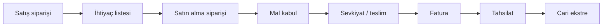
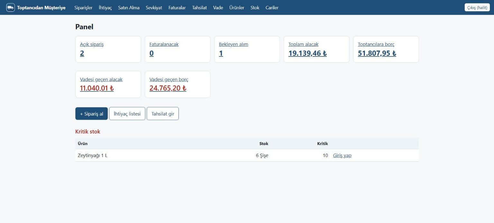
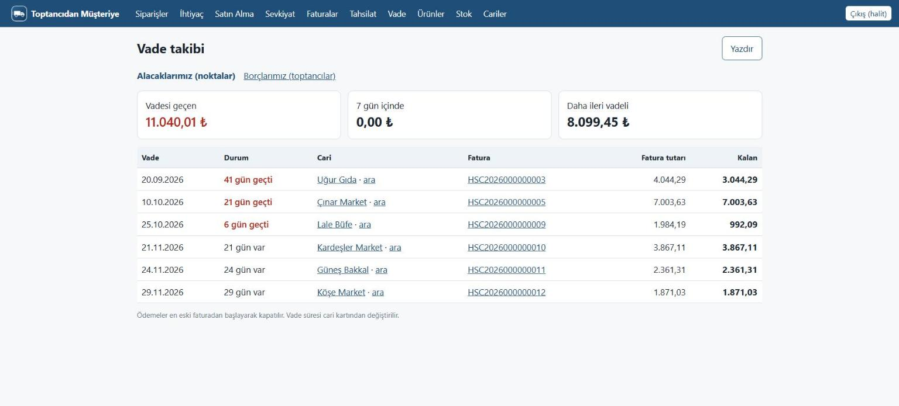
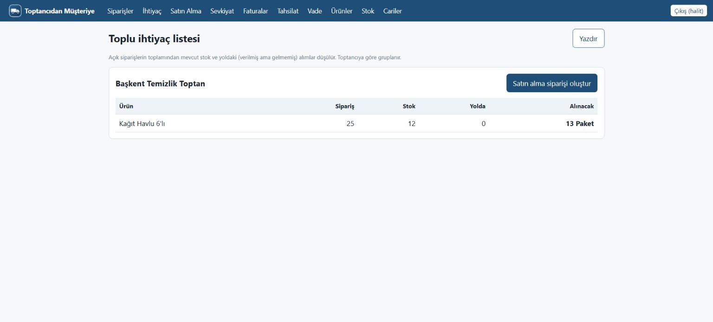
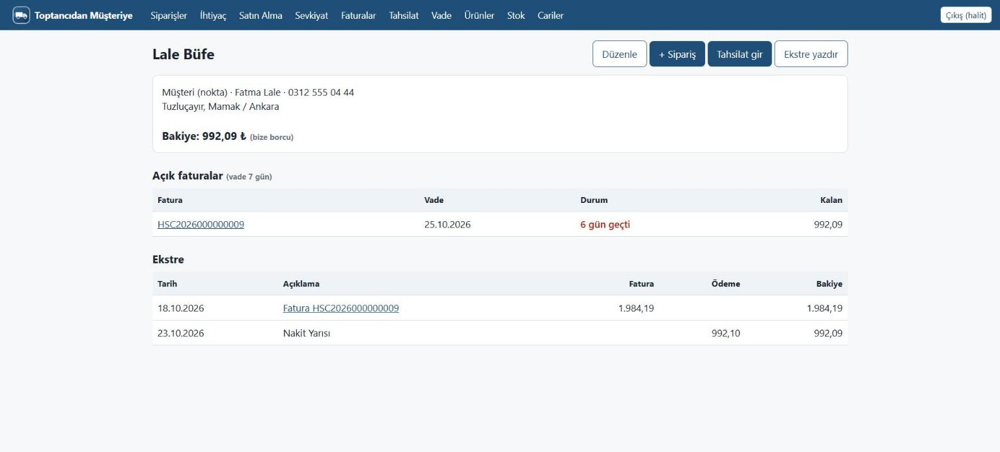
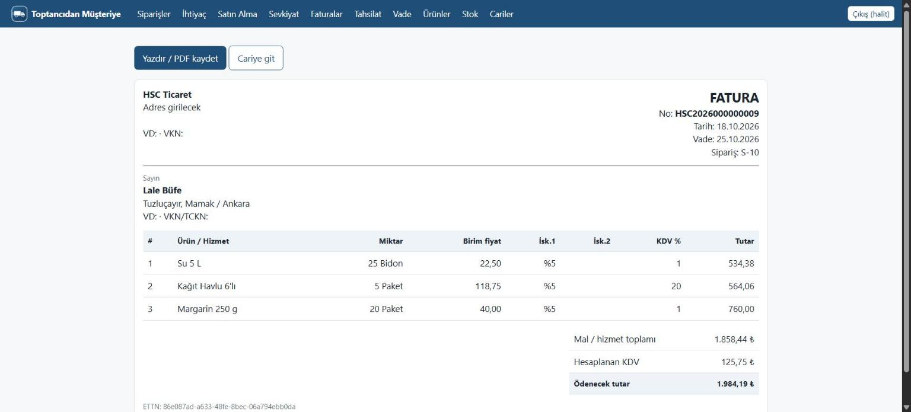

# 📦 Toptancıdan Müşteriye

Küçük bir dağıtım işi için **ERP mantığıyla çalışan** sipariş ve cari takip uygulaması.

Gerçek bir dağıtım işinin satış, satın alma, stok ve finans süreçlerini tek bir veritabanında, entegre çalışan bir sistemde toplar. Bir işlem yapıldığında stok, cari hesap ve raporlar birlikte güncellenir.

> **Not:** Bu depo bir tanıtım deposudur. Kaynak kod gizlidir. Görsellerdeki veriler kurgusaldır.

## İş süreci

Noktalardan sipariş toplanır, toptancıdan alınır, kâr eklenip teslim edilir, fatura kesilip tahsilat yapılır.

## Modüller ve süreçler

| Modül | Ne yapar |
|---|---|
| **Satış (Order-to-Cash)** | Sipariş → Sevkiyat → Fatura → Tahsilat → Cari ekstre |
| **Satın Alma (Procure-to-Pay)** | İhtiyaç listesi → Satın alma siparişi → Mal kabul → Tedarikçi borcu |
| **Stok** | Mal kabulde artar, teslimde düşer. Eldeki ve yoldaki mal düşülerek net ihtiyaç hesaplanır, toptancıya ne sipariş verileceği otomatik çıkar. |
| **Fiyatlama** | Alış + ürün bazında kâr oranı, kademeli iskonto. Mal kabulde alış fiyatı güncellenir. |
| **Finans / Cari** | Müşteri ve tedarikçi carileri, vade takibi. Ödemeler en eski faturadan kapanır (FIFO), vadesi geçen alacaklar kırmızıyla görünür. |
| **Yönetim paneli** | Açık siparişler, alacaklar, borçlar, geciken tahsilatlar ve kritik stok tek ekranda. |

## Ekran görüntüleri

**Yönetim paneli**

**Vade takibi**

**İhtiyaç listesi**

**Cari ekstre**

**Fatura**

## Claude ile geliştirme

Kodun büyük kısmını Claude Code yazdı. Benim işim süreci tasarlamak ve doğrulamaktı:

- İş kurallarını netleştirmek (kâr oranı, iskonto, vade süresi, ödemenin hangi faturayı kapatacağı)
- Süreç akışını ve belgeler arasındaki bağlantıyı tasarlamak
- Her adımın stoğa ve cariye etkisini gerçek işe göre kontrol etmek
- Testlerle doğrulamak, kurgusal veriyle senaryoları denemek (vadesi geçmiş, kısmi ödenmiş, pasif ama borçlu hesap)

## Teknolojiler

Python · Django · SQLite · Claude Code
